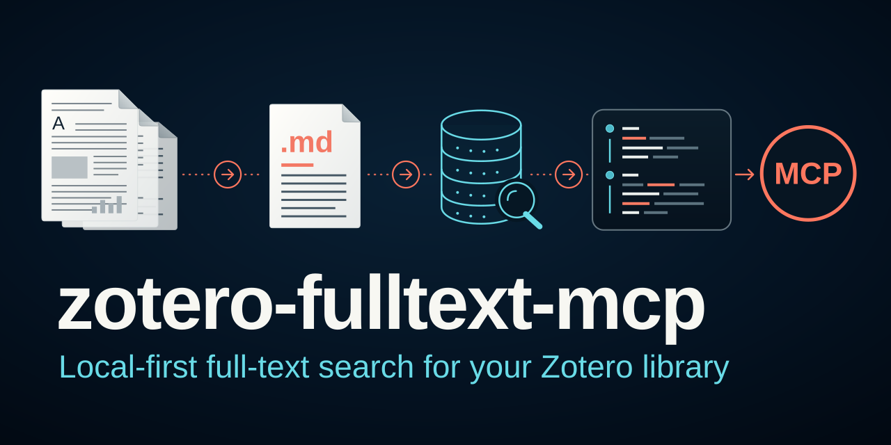

# zotero-fulltext-mcp

[](https://github.com/matthiaskloft/zotero-fulltext-mcp/actions/workflows/ci.yml)
[](https://github.com/matthiaskloft/zotero-fulltext-mcp/releases)
[](https://pypi.org/project/zotero-fulltext-mcp/)
[](LICENSE)



Search and read the full text of your Zotero papers from an AI assistant. This project
converts linked PDFs to Markdown and builds a local search index, available through an
MCP server for clients such as Claude Code and Codex.

## What you can do

- **Search across your papers' full text** and narrow results by author, title, citation key,
  or publication year.
- **Read the passages behind an answer**, search within one paper, and retrieve papers by
  their Better BibTeX citation keys. Source locators let your assistant check that a cited
  passage has not changed.
- **Export BibTeX/BibLaTeX references** for the papers you use, with the optional Better BibTeX
  integration enabled and Zotero running.
- **Add papers by DOI and attach PDFs** through explicit CLI commands, using Zotero's PDF
  lookup, a direct PDF URL, or a local file with the recommended debug-bridge/ZotMoov setup.
- **Keep a readable Markdown library** with extracted images, add newly linked PDFs to the
  index, and check for missing or outdated conversions.
- **Search locally with Zotero closed** once the index is built. Your MCP client can give an
  assistant access to retrieved text without uploading the whole library.

Conversion and search read your Zotero library and write to a separate output folder.
Optional CLI commands can add items or attachments through Zotero; they are explicit actions.
The MCP server never writes to Zotero, and tools that change converted text are disabled by default.

> **Active development (0.x).** Releases may change commands or output formats. Install a
> pinned release and read the [changelog](CHANGELOG.md) before upgrading. Converted text and
> the index can be rebuilt from your PDFs.

## Recommended Zotero setup

Use a **personal Zotero library with linked PDF attachments**, managed by ZotMoov, plus
Better BibTeX and its separate debug-bridge plugin. This gives you an everyday workflow for
adding papers, organizing PDFs, searching their text, and exporting citations.

1. **Install [ZotMoov](https://github.com/wileyyugioh/zotmoov/releases/latest).** In its settings,
   set **Directory to Move Files To** to a dedicated PDF folder, choose **Move** as the file
   behavior, and enable **Automatically Move/Copy Files When Added**. Move creates linked
   attachments; Copy creates external backups rather than linked attachments. See the
   [ZotMoov settings](https://github.com/wileyyugioh/zotmoov/blob/master/docs/SETTINGS_INFO.md).
2. **Set Zotero's Linked Attachment Base Directory** to that same PDF folder under
   Settings → Advanced → Files and Folders. This lets Zotero resolve relative attachment paths;
   ZotMoov's destination setting controls where new files go. For existing stored PDFs,
   back up your library first, then use ZotMoov's **Move Selected to Directory** action.
3. **Install [Better BibTeX](https://retorque.re/zotero-better-bibtex/installation/)** for citation
   keys and BibTeX/BibLaTeX export.
4. **Install the [debug-bridge XPI](https://github.com/retorquere/zotero-better-bibtex/releases/tag/debug-bridge)**
   separately. It is a development plugin from the Better BibTeX project, not part of the
   regular Better BibTeX installation. It lets the CLI check live attachments and ask Zotero
   to import a DOI or find a PDF.

Install each XPI in Zotero through Tools → Plugins → gear menu → Install Plugin From File.
For the bridge, generate a token with `python -c "import secrets; print(secrets.token_urlsafe(32))"`,
set it as the String preference `extensions.zotero.debug-bridge.token` in Zotero's Config Editor,
and set the same value in the `ZOTERO_DEBUG_BRIDGE_TOKEN` environment variable. Restart Zotero.
Follow the [bridge setup guide](docs/debug-bridge-setup.md) for exact commands and a read-only
verification. The bridge can execute JavaScript inside Zotero; keep its token private.

For multiple computers, use this split:

- **Zotero database and internal indexes:** keep the entire `zotero_data_directory` local on
  each computer, outside Dropbox, OneDrive, Nextcloud, or other sync folders. Use Zotero's
  own online sync for metadata, collections, tags, and notes. Syncing the database files
  directly risks corruption; see [Zotero's guidance](https://www.zotero.org/support/kb/data_directory_in_cloud_storage_folder).
- **Linked PDFs:** sync the separate `linked_attachments` folder with your preferred file-sync
  tool. Set Zotero's Linked Attachment Base Directory on each computer to its local copy.
  Zotero's online file sync does not transfer linked PDFs.
- **Converted text and this project's search index:** you can sync `output_root` separately.
  Choose one computer to run conversion and index updates, and let file sync finish before
  searching on another computer. A synced lock file cannot prevent simultaneous writers
  across computers. See [Multi-machine operation](docs/operations.md#multi-machine-write-lock).

Linked files are not supported in group libraries or Zotero's mobile apps; see
[Zotero's linked-file documentation](https://www.zotero.org/support/attaching_files#linked_files).

ZotMoov, Better BibTeX, and debug-bridge are recommended for this workflow. If you already
have linked PDFs and only want conversion and search, those plugins are optional.

## Install

You need **Python 3.11 or later**, **Git** for the tagged install below, and an MCP client.
Create a dedicated virtual environment outside any folder you sync between computers.

Windows (PowerShell):

```powershell
$venv = "$env:USERPROFILE\.venvs\zotero_fulltext_mcp"
py -3.11 -m venv $venv
$python = "$venv\Scripts\python.exe"
& $python -m pip install "zotero-fulltext-mcp[mcp] @ git+https://github.com/matthiaskloft/zotero-fulltext-mcp.git@v0.14.0"
```

macOS/Linux:

```bash
python3 -m venv ~/.venvs/zotero_fulltext_mcp
python=~/.venvs/zotero_fulltext_mcp/bin/python
"$python" -m pip install 'zotero-fulltext-mcp[mcp] @ git+https://github.com/matthiaskloft/zotero-fulltext-mcp.git@v0.14.0'
```

Use a published tag from the [releases page](https://github.com/matthiaskloft/zotero-fulltext-mcp/releases).
The examples pin the version documented by this checkout. For reproducible installs and local
testing with `uv`, see [Developer setup](docs/dev-test-setup.md).

## Configure

Create a workspace folder for this project's data and save a `config.json` there.
Start with the four required paths below, or use the [full example](config.example.json).
Replace the examples with **absolute paths** on your computer; create the workspace and linked
PDF folders before continuing.

```json
{
  "zotero_root": "C:/Users/you/ZoteroFullText",
  "zotero_data_directory": "C:/Users/you/Zotero",
  "linked_attachments": "C:/Users/you/ZoteroFullText/linked_pdfs",
  "output_root": "C:/Users/you/ZoteroFullText/converted_text"
}
```

| Setting | What to choose |
| --- | --- |
| `zotero_root` | The workspace folder you created for this project's data. |
| `zotero_data_directory` | Zotero's actual data directory, containing `zotero.sqlite`. Find it in Zotero's advanced settings. |
| `linked_attachments` | The PDF folder configured in ZotMoov and as Zotero's Linked Attachment Base Directory. |
| `output_root` | A separate folder for converted Markdown, images, reports, and the index. |

On macOS/Linux, use paths such as `/home/you/ZoteroFullText` instead. Keep your real config
private and outside the source checkout. The commands below pass its path explicitly, so
neither the config nor your data needs to live beside the installed code.

## Build the index

The remaining examples use PowerShell and the `$python` variable from installation.
Set `$config` to the file you just created:

```powershell
$config = "C:\Users\you\ZoteroFullText\config.json"
& $python -m zotero_pdf_text check-setup --config $config
& $python -m zotero_pdf_text dry-run --config $config
& $python -m zotero_pdf_text convert-new --config $config
& $python -m zotero_pdf_text check-setup --require-mcp --config $config
```

In bash, set `config=/path/to/config.json` and use
`"$python" -m zotero_pdf_text <command> --config "$config"` for each command above and below.

`check-setup` checks paths and installed dependencies. `dry-run` writes a mapping report
without converting PDFs or changing Zotero. Inspect its summary; if it reports unmatched
PDFs or uncertain matches, follow [Library cleanup](docs/library-cleanup.md).
`convert-new` converts newly linked, verified PDFs and publishes the search index.
The first conversion can take a while; later runs add newly linked papers.

Converted papers live under `output_root/library/`; reports are under `output_root/runs/`.
For interrupted runs, selective repairs, and index maintenance, see
[Operations](docs/operations.md).

## Connect your assistant

Generate the registration after building the index:

```powershell
& $python -m zotero_pdf_text install-mcp --config $config --enable-bibtex
```

This prints a Claude Code command and a Codex `config.toml` block with your environment,
config, and index paths already filled in:

- **Claude Code:** run the printed command, or rerun `install-mcp` with `--apply` to register it.
- **Codex:** paste the printed block into your user `config.toml`, replacing an existing entry
  for this server if present.

Restart your MCP client and check that `zotero-fulltext` connects and its tools are available.
`--enable-bibtex` adds citation export through Better BibTeX, which requires Zotero running.
Omit that flag for search and reading alone. Add `--enable-zotero-launch` to let your
assistant open Zotero itself (the `start_zotero` tool) instead of asking you to; pass
`--zotero-exe PATH` if Zotero is not installed in the default location. The debug bridge is
used by the CLI and does not need to be registered as an MCP server.

For registration updates, optional OCR tools, and client configuration details, see
[Advanced setup](docs/advanced-setup.md).

## Everyday use

Try asking your assistant:

- “Find papers about measurement invariance and show the passages supporting your answer.”
- “Find papers by this author from 2018 to 2024.”
- “Read the methods section of the paper with citation key `smith2024`.”
- “Export the BibTeX entries for the papers we used.”

Read the retrieved passages before relying on an answer. PDF extraction can lose equations
or misread scanned pages; equations that converted as images stay viewable through
`get_passage_image`. Passages give their physical PDF pages when they were recorded at conversion,
and `get_page` shows a whole page to check a quote. Search covers the **converted index**, so a missing hit does not
prove a paper is absent from Zotero. Ask the assistant to check `library_status` when coverage
or freshness matters. The [MCP tool reference](docs/mcp-tools.md) explains retrieval,
source locators, citation handling, and guidance for agents.

After adding PDFs in Zotero and letting ZotMoov finish moving them, update the index:

```powershell
& $python -m zotero_pdf_text convert-new --config $config
```

With Zotero running and the debug bridge configured, you can also import a paper by DOI
and ask Zotero to find an available PDF:

```powershell
& $python -m zotero_pdf_text import-doi --doi "<DOI>" --with-pdf --config $config
```

This command changes your Zotero library. If no PDF is found, attach one you can access
and rerun `convert-new`. If a bridge operation times out or reports `unknown` or `unsettled`,
check Zotero before retrying: it may already have made the change. See
[Adding papers and attaching PDFs](docs/debug-bridge-setup.md#adding-papers-and-attaching-pdfs)
for local-file and direct-PDF-URL workflows.

This server focuses on full-text search. For live collections, notes, and metadata editing,
you can pair it with a separate Zotero metadata MCP server; that is optional for this setup.

## Further reading

- [Troubleshooting](docs/troubleshooting.md) — setup failures, upgrades, and extraction problems.
- [Operations](docs/operations.md) — CLI commands, resume, audits, repairs, and experimental image OCR.
- [MCP tool reference](docs/mcp-tools.md) — tool contracts and agent guidance.
- [Architecture](docs/architecture.md) and [data dictionary](docs/data-dictionary.md) — pipeline design and schemas.
- [Contribution policy](CONTRIBUTING.md) — issues welcome; pull requests by invitation only.
- [Developer guide](docs/contributing.md) — development, test workflows, privacy checks, and repository history.
- [Releasing](docs/releasing.md) — maintainer release procedure.

For problems, use the
[bug report template](https://github.com/matthiaskloft/zotero-fulltext-mcp/issues/new?template=bug_report.yml).
Issues are public; remove private paper text, identifying metadata, local paths, and credentials.

## License

[MIT](LICENSE).
